### Pratham Jaiswal

Systems & automation engineer, Kolkata. I send patches upstream and build the machinery that stops teams doing things by hand.

**22 merged pull requests · 13 upstream repositories**

[Résumé (PDF)](./resume/Pratham-Jaiswal-Resume.pdf) · [Detailed résumé](./resume/Pratham-Jaiswal-Resume-detailed.pdf) · [Email](mailto:pratham.jaiswal2004@gmail.com) · [LinkedIn](https://www.linkedin.com/in/pantha704) · [X](https://twitter.com/pantha704)

---

#### Upstream work

**[rust-lang/rustc_codegen_cranelift](https://github.com/rust-lang/rustc_codegen_cranelift)** — compiler backend
`#1625` merged — ported a disk-cleanup workflow that fixed CI runner exhaustion and restored abi-cafe test reliability
`#1711` open — ICE on `const` asm operands pointing at anonymous allocations

**[CCExtractor/ccextractor](https://github.com/CCExtractor/ccextractor)** — subtitle extraction, C
`#2378` merged — wrong tx3g subtitle timings on the FFmpeg MP4 path; the demuxer trusted a shared timing pointer that interleaved tracks had already advanced. Now reads packet PTS.

**[google-deepmind/open_spiel](https://github.com/google-deepmind/open_spiel)** — game-theory research
`#1455` merged — replaced the TensorFlow 1.x deep-RL examples with PyTorch

**[pytorch/ao](https://github.com/pytorch/ao)** — quantization
`#3709` merged — documented `FqnToConfig` and mixture-of-experts parameter quantization

**[CircuitVerse/cv-frontend-vue](https://github.com/CircuitVerse/cv-frontend-vue)** — circuit simulator
6 merged — dropped jQuery from the engine, setup and minimap modules; converted subcircuit, events, sequential and LSB/MSB to TypeScript during the v1 migration

Also merged into Razorpay payment flow, telemetry and persistent queue storage, video quality scoring, Google OAuth and JWT decoding. Open pull requests with `gatsbyjs/gatsby` and `aboutcode-org/scancode-toolkit`.

---

#### Things I build

**Perfume Store** — production commerce system. Catalogue, admin console, dispatch and tracking, India Post integration, variant pricing. TypeScript / Next.js.
**Homeworker** — PDF and image input to reviewable A4 notes in licensed handwriting typefaces. Local-first, Python.
**FlowForge** — serverless automation separating frontend events from durable background jobs. Upstash QStash.

---

#### Stack

`Rust` `TypeScript` `Python` `Go` `Node.js` `Next.js` `PostgreSQL` `Redis` `Docker` `Linux` `Anchor`

---

<sub>Open to systems, automation and developer-tooling work. Resume above, or mail me.</sub>

---

#### the readme plays its own demo



Twenty-seven frames captured once from `ascii.live/rick` and stored in this repo as
[`assets/rick.frames.txt`](assets/rick.frames.txt). It plays here with no network, no scripts and no
external service — and the same frames play in a terminal:

```bash
python3 tools/play.py
```

`q` quit · `space` pause · `f`/`s` speed. Rebuild the SVG with `python3 tools/build_tui_svg.py`.
