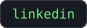

### pratham jaiswal

`systems & automation` · `rust` · `typescript` · `python` · `go`

   

---

<!--stats:start--><code>19 merged · 10 repos · 14 open · checked 23 Oct 2026</code><!--stats:end--> — the hero above and these numbers are rebuilt daily from the GitHub API by <a href="tools/refresh_stats.py">tools/refresh_stats.py</a>. The animation is a random pick per load from the frames in <a href="assets/frames">assets/frames</a>.
