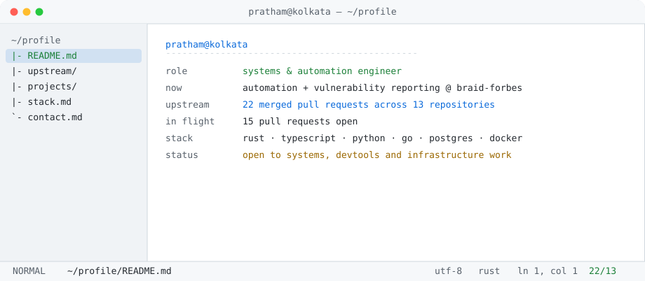

### pratham jaiswal

`systems & automation` · `rust` · `typescript` · `python` · `go`

[resume](./resume/Pratham-Jaiswal-Resume.pdf) · [detailed](./resume/Pratham-Jaiswal-Resume-detailed.pdf) · [mail](mailto:pratham.jaiswal2004@gmail.com) · [linkedin](https://www.linkedin.com/in/pantha704) · [x](https://twitter.com/pantha704)

<a href="#upstream" title="jump to ~/upstream"><picture>
  <source media="(prefers-color-scheme: dark)" srcset="./assets/hero-dark.svg">
  
</picture></a>

<kbd>~/profile</kbd> · [<kbd>~/upstream</kbd>](#upstream) · [<kbd>~/projects</kbd>](#projects) · [<kbd>~/stack</kbd>](#stack) · [<kbd>~/terminal</kbd>](#terminal) · [<kbd>interactive ↗</kbd>](https://pantha704.github.io/pantha704/)


---

#### ~/upstream

<details open>
<summary><!--upstream:start-->19 merged · 10 repositories · 13 open<!--upstream:end--></summary>
<br>

| repository | pr | what changed |
| --- | --- | --- |
| [rust-lang/rustc_codegen_cranelift](https://github.com/rust-lang/rustc_codegen_cranelift/pull/1625) | `#1625` | CI runner disk exhaustion broke abi-cafe tests — ported the cleanup workflow |
| [CCExtractor/ccextractor](https://github.com/CCExtractor/ccextractor/pull/2378) | `#2378` | tx3g subtitle times wrong on the FFmpeg MP4 path — demuxer trusted a shared timing pointer |
| [google-deepmind/open_spiel](https://github.com/google-deepmind/open_spiel/pull/1455) | `#1455` | legacy TensorFlow 1.x deep-RL examples → PyTorch |
| [pytorch/ao](https://github.com/pytorch/ao/pull/3709) | `#3709` | documented `FqnToConfig` and MoE parameter quantization |
| [CircuitVerse/cv-frontend-vue](https://github.com/CircuitVerse/cv-frontend-vue/pulls?q=is%3Apr+author%3Apantha704+is%3Amerged) | `×6` | dropped jQuery from engine/setup/minimap, ported four modules to TypeScript |
| [Bijoy99roy/scheduler](https://github.com/Bijoy99roy/scheduler/pull/7) | `#7` `#13` | telemetry + retry, persistent queue storage |

<sub>Every link here opens without an account, and the counts include only repositories a visitor can open. Private client work — Razorpay payment flow, video quality scoring, Android release tooling — is excluded.</sub>

**in flight** — [rust-clippy](https://github.com/rust-lang/rust-clippy/pull/16375) `#16375` type-based checks in `arithmetic_side_effects` · [wagtail](https://github.com/wagtail/wagtail/pull/13708) `#13708` `#13709` comment textarea overflow, tooltip styles · [gatsby](https://github.com/gatsbyjs/gatsby/pull/39703) `#39703` `assetPrefix` in manifest icon paths · [scancode-toolkit](https://github.com/aboutcode-org/scancode-toolkit/pull/4765) `#4765` `#4766` OSGi/.bnd parsing, authenticated Git deps

</details>

#### ~/projects

<details open>
<summary>5 shipped</summary>
<br>

| project | stack | what it is |
| --- | --- | --- |
| [Perfume Store](https://github.com/pantha704/perfume-store) | TypeScript · Next.js | production commerce system — catalogue, admin console, dispatch, India Post integration, 60+ reviewed PRs |
| [Homeworker](https://github.com/pantha704/home-worker) | Python | local-first pipeline: PDF and image input to reviewable A4 notes in licensed handwriting typefaces |
| FlowForge | Next.js · Upstash QStash | serverless automation separating frontend events from durable background jobs |
| [MacFolio](https://mac-folio-three.vercel.app) | React · Zustand · GSAP | macOS simulation in the browser — draggable, resizable windows with window-manager state |
| Turbin3 · Solana | Rust · Anchor | Q4 '25 Builder + Q1 '26 Accelerate — NFT marketplaces, staking, vaults, escrow, AMMs |

</details>

#### ~/stack

<details open>
<summary>what I reach for</summary>
<br>

`rust` (compiler internals) · `typescript` · `python` · `go` · `solidity` · `next.js` · `react` · `node` · `anchor` · `prisma` · `postgresql` · `redis` · `docker` · `linux` · `github actions` · `n8n` · `monday.com` · `playwright`

</details>

#### ~/terminal

<details open>
<summary>the animation at the top</summary>
<br>

Frames captured once from [ascii.live's animation list](https://ascii.live/list) into [`assets/frames/`](assets/frames); the server picks a random one per request, so a reload gets a different animation. There is also a [fully interactive version of this terminal](https://pantha704.github.io/pantha704/) — the sidebar there actually switches panels. The same frames play locally:

```bash
python3 tools/play.py            # random animation each run
python3 tools/play.py --name nyan
python3 tools/play.py --list
```

Capture any of ascii.live's ninety-odd animations with `python3 tools/capture_frames.py <name>`; rebuild the panels with `python3 tools/build_tui_svg.py --all` and `python3 tools/build_hero_svg.py`.

</details>

---

<sub><!--stats:start--><code>19 merged · 10 repos · 13 open · checked 22 Oct 2026</code><!--stats:end--> — the hero above and these numbers are rebuilt daily from the GitHub API by <a href="tools/refresh_stats.py">tools/refresh_stats.py</a>. Panels collapse; the keys under the animation jump to each section.</sub>
